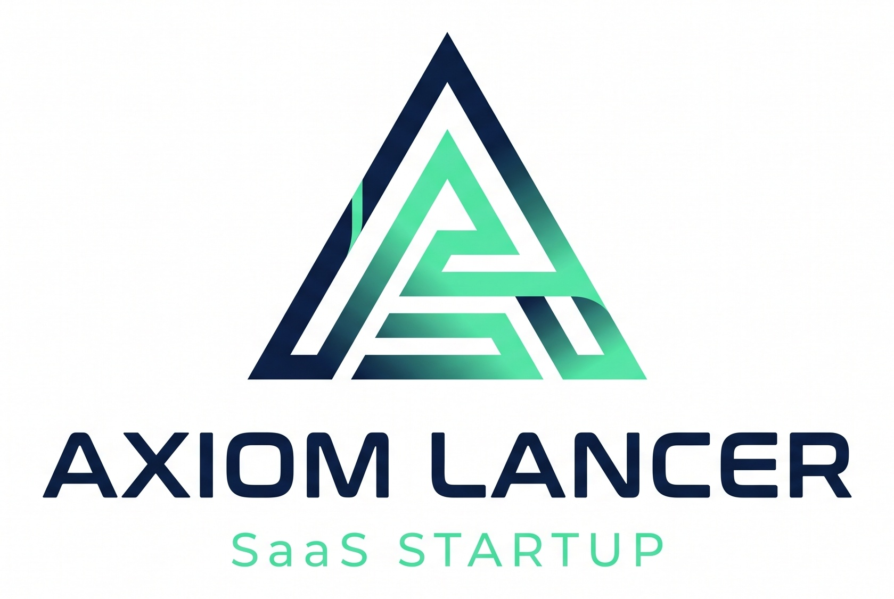

# AxiomLancer — Core Domain & Full Stack Architecture

<p align="center">
  
</p>

[]()
[]()
[]()
[]()
[]()
[]()
[]()
[]()

> **Documentação Normativa (Single Source of Truth)**  
> Este documento define as fronteiras arquiteturais, os contratos de integração, as garantias de conformidade regulatória e as diretrizes operacionais do repositório **AxiomLancer**. Qualquer alteração estrutural deve respeitar integralmente os princípios e invariantes aqui estabelecidos e ser formalmente registrada em `/docs/adr/`.

---

## 1. Visão Executiva e Escopo do Produto

O **AxiomLancer** é uma plataforma de engenharia financeira e faturamento autônomo projetada especificamente para freelancers seniores e agências boutique de tecnologia. O sistema resolve a dor central do negócio — o atrito humano, o constrangimento social e o desperdício de horas operacionais na cobrança manual de clientes —, garantindo consistência transacional estrita, isolamento multitenant à prova de falhas, liquidação preditiva e alta disponibilidade.

* **Bounded Contexts Canônicos:**
  * **Execução Financeira & PIX Dinâmico:** Emissão de cobranças, geração determinística de payloads BACEN (CRC16-CCITT), conciliação e liquidação em tempo real.
  * **Régua de Notificação Multicanal & Idempotência:** Máquina de estados de comunicação (D-3 a D+7) com tom adaptativo e controle estrito anti-duplicação via `DeduplicationJournal` (SHA-256).
  * **Motor Tributário & Split Automatizado:** Segregação automática do Simples Nacional (Fator R / Anexo III vs. Anexo V) com retenção imediata em Cofre Virtual do DAS no momento da liquidação.
  * **Gestão Contratual & Não-Repúdio:** Gestão de ciclo de vida contratual com aceite digital imutável (timestamp UTC, IP e hash criptográfico SHA-256).
  * **Inteligência de Liquidez (Previsio BI):** Projeção preditiva de fluxo de caixa em horizontes de 7 a 90 dias com 4 cenários probabilísticos ponderados por score de confiabilidade.
  * **Ciclos de Avaliação & Reputação:** Mensuração qualitativa 360° em 5 dimensões com gatilhos automáticos por marcos contratuais.
* **Público e Criticidade:** Operação B2B multi-tenant com impacto financeiro direto em contas bancárias, conciliação e obrigações fiscais da Receita Federal do Brasil (RFB).
* **Métricas de Sucesso (SLIs / SLOs):**
  * **Disponibilidade Global:** $\ge 99.9\%$ da esteira de conciliação e APIs operacionais em horário comercial e janelas de liquidação.
  * **Latência de API (Edge & Node Handlers):** $p95 < 120\text{ms}$ e $p99 < 250\text{ms}$.
  * **Latência Crítica do Botão de Pânico (Safe Mode):** $< 12\text{ms}$ para congelamento atômico global no cluster de estado (Convex).
  * **Core Web Vitals:** `CLS = 0` (Zero Cumulative Layout Shift), `LCP < 1.2s`, `INP < 80ms`.
  * **Integridade Transacional & Acurácia Numérica:** $100\%$ de idempotência em disparos externos e $0\%$ de erro por imprecisão de ponto flutuante IEEE 754.

### Proposta de Valor e Modelo de Negócio (7Keys)

```text
┌─────────────────────────────────────────────────────────────────────────────────┐
│                           MODELO DE MONETIZAÇÃO 7KEYS                           │
├───────────────────────┬───────────────────────────────┬─────────────────────────┤
│ Assinatura Core       │ R$ 49,90 / mês                │ Acesso à infraestrutura │
│ Success Fee           │ 5,00% sobre faturas vencidas  │ Apenas sobre recebíveis │
│                       │ efetivamente recuperadas      │ recuperados pelo motor  │
│ Recebimento Pontual   │ R$ 0,00 de comissão           │ Taxa zero sobre faturas │
│                       │                               │ quitadas até o vencimento│
└───────────────────────┴───────────────────────────────┴─────────────────────────┘
```

---

## 2. Arquitetura de Software e Stack Tecnológica

A base de código adota rigorosamente os pilares de **Clean Architecture**, **Hexagonal Architecture (Ports & Adapters)**, **Domain-Driven Design (DDD)** e **Screaming Architecture**. A lógica pura do negócio reside no núcleo (`core/`), blindada contra qualquer acoplamento com protocolos de transporte, frameworks web, ORMs ou SDKs externos.

```text
       ┌────────────────────────────────────────────────────────┐
       │                Presentation (Next.js 15)               │
       │       App Router · Server Components · Route Handlers  │
       └───────────────────────────┬────────────────────────────┘
                                   │ Invoca via DTOs/Schemas Zod
                                   ▼
       ┌────────────────────────────────────────────────────────┐
       │               Core Layer (Domínio Puro)                │
       │   Entities · Value Objects · Use Cases · Domain Ports  │
       │     (Zero dependências de frameworks ou bibliotecas)   │
       └───────────────────────────▲────────────────────────────┘
                                   │ Implementa Contratos (DIP)
       ┌───────────────────────────┴────────────────────────────┐
       │               Infrastructure (Adapters)                │
       │   Convex Adapter · Prisma/SQL · InMemory Repositories  │
       │   BACEN PIX (CRC16) · Workers de Fundo · OpenTelemetry │
       └────────────────────────────────────────────────────────┘
```

| Camada | Stack & Ferramentas | Responsabilidade Arquitetural |
| :--- | :--- | :--- |
| **Frontend (UI & Edge)** | Next.js 15 (App Router), React 19, TypeScript (`strict`), Tailwind CSS v3.4, Radix UI, Framer Motion, Lucide | Renderização híbrida com **React Server Components (RSC)** puros sem `"use client"` por padrão; *Client Islands* isoladas apenas quando estritamente necessário para interatividade; Grid de 8px e APCA contrast compliance. |
| **Backend & APIs** | Next.js Route Handlers (Edge & Node.js 22 LTS), Zod 3.25, jose 5.9 | Orquestração de casos de uso, validação de borda *Fail Fast*, rate-limiting, autenticação BFF e contratos tipados com rewrites automáticos `/api/v1/:path*` $\to$ `/api/:path*`. |
| **Domínio Puro (Core)** | TypeScript Puro, decimal.js 10.4, Node Crypto | Entidades de domínio ricas, Value Objects (`PixPayload`, `EventId`), serviços puros de domínio, invariantes financeiras e abstrações de repositório (*Ports*). |
| **Persistência & Estado Híbrido** | Convex 1.48 (Serverless Realtime State) & PostgreSQL 16 (Schema Canônico `AxiomLancer.sql` / Prisma) | Mutações atômicas e reatividade em tempo real para o Safe Mode (< 12ms) via Convex; consistência forte (**ACID**), constraints de chave única e campos `DECIMAL(12,2)` no PostgreSQL para integridade fiscal. |
| **Observabilidade & Infra** | Docker, Vercel Edge Platform, GitHub Actions, Vitest 5.0 | Pipelines de CI/CD automatizados, testes com isolamento determinístico, análise estática de tipos e auditoria de segurança contínua. |

### Decisões Arquiteturais Registradas (ADRs)

* **ADR-001: Adoção de Monólito Modular Hexagonal vs. Microsserviços Distribuídos**  
  *Contexto:* Evitar custos desnecessários de infraestrutura, serialização de rede e transações distribuídas (2PC/Sagas) em fase de tração do produto.  
  *Decisão:* Implementar um monólito modular estruturado em *Ports & Adapters*, mantendo isolamento absoluto entre `core/`, `infrastructure/` e `app/`. O domínio é desacoplado a ponto de permitir extração para microsserviços sem reescrita de regras de negócio.
* **ADR-002: Isolamento de Sessão via Padrão BFF com Cookies HttpOnly e Zero Secrets**  
  *Contexto:* Proteger a aplicação contra ataques XSS (Cross-Site Scripting) e vazamento de tokens em storage local do navegador.  
  *Decisão:* Tokens JWT HS256 trafegam exclusivamente em cookies com flags `HttpOnly`, `Secure` e `SameSite=Strict`. As chaves de criptografia e credenciais administrativas nunca são embutidas em código ou acessíveis no client-side; boot da aplicação valida o schema do `.env` e aborta imediatamente (*Fail Fast*) se houver chaves ausentes.
* **ADR-003: Persistência Híbrida — Reatividade no Convex e Consistência ACID no PostgreSQL**  
  *Contexto:* Necessidade simultânea de atualização de UI em tempo real com reação instantânea a bloqueios emergenciais (< 12ms) e rigor formal contábil/fiscal.  
  *Decisão:* O Convex atua como orquestrador de estado reativo e controle de concorrência serverless para o Botão de Pânico. O PostgreSQL (schema `AxiomLancer.sql`) atua como autoridade canônica de dados transacionais com precisão de ponto fixo `DECIMAL(12,2)` e integridade referencial.
* **ADR-004: Aritmética Monetária Arbitrária e Idempotência Estrita no DeduplicationJournal**  
  *Contexto:* O padrão IEEE 754 de números de ponto flutuante em JavaScript causa erros cumulativos em divisões de taxas, retenções e juros compostos.  
  *Decisão:* Todo cálculo financeiro utiliza obrigatoriamente a biblioteca `decimal.js` configurada com `ROUND_HALF_UP`. Todo disparo de cobrança gera um hash criptográfico SHA-256 no `DeduplicationJournal` com restrição de unicidade determinística.
* **ADR-005: Inversão de Dependência (DIP) Estrita com Injeção 100% Explícita**  
  *Contexto:* Serviços acoplados a bancos de dados ou bibliotecas de terceiros inviabilizam testes unitários velozes e determinísticos.  
  *Decisão:* Nenhuma classe ou serviço na camada `core/` instancia seus próprios repositórios. Todas as dependências são fornecidas via construtor através de interfaces (*Ports*), possibilitando execução da suíte de 98 testes em menos de 1,5 segundo em memória.

---

## 3. Topologia de Diretórios e Governança Semântica

A estrutura de pastas expressa com clareza a intenção do domínio e a separação de responsabilidades. O repositório impõe as seguintes regras semânticas:
* **Pastas e arquivos lógicos:** obrigatoriamente em `kebab-case` (ex: `create-invoice.use-case.ts`, `pix-payload.vo.ts`, `cycle-evaluation.service.ts`).
* **Classes, Interfaces, Tipos e Componentes:** obrigatoriamente em `PascalCase` (ex: `ContractService`, `Invoice`, `DeduplicationJournal`).
* **Proibição de "valetas" genéricas:** pastas como `utils/` ou `helpers/` na raiz do projeto são expressamente proibidas. Funções utilitárias pertencem aos serviços especializados da camada `core/` ou ao seu respectivo *Bounded Context*.

```text
C:\Dev\AxiomLancer/
├── .github/
│   └── workflows/                       # Automação de CI/CD, linter e execução de testes
├── app/                                 # [Presentation Layer — Next.js 15 App Router]
│   ├── api/                             # Route Handlers tipados com validação Zod
│   │   ├── auth/                        # Endpoints de login (timingSafeEqual) e logout BFF
│   │   ├── billing-rules/               # Consulta e ativação da régua de cobrança D-3 a D+7
│   │   ├── clients/                     # CRUD de clientes com isolamento multitenant (BOLA-safe)
│   │   ├── contracts/                   # Máquina de estados contratual e aceite digital
│   │   │   └── [id]/accept/             # Rota de assinatura com não-repúdio e hash SHA-256
│   │   ├── cycle-evaluations/           # Sistema de avaliação de ciclo (5 dimensões qualitativas)
│   │   │   ├── [token]/                 # Acesso público assinado via token para clientes
│   │   │   └── trigger/                 # Gatilho manual e assíncrono de milestone
│   │   ├── dashboard/summary/           # DRE resumido, caixa realizado e margem real
│   │   ├── dre/                         # Demonstrativo de Resultados do Exercício
│   │   ├── expenses/                    # Gestão de despesas operacionais (OPEX)
│   │   ├── feedbacks/                   # Registro de feedback por projeto
│   │   ├── invoices/                    # Faturas, emissão de PIX dinâmico e recuperação
│   │   │   └── [id]/recover/            # Cálculo de success fee (5%) sobre faturas vencidas
│   │   ├── message-templates/           # Templates de e-mail e WhatsApp adaptados ao tom
│   │   ├── panic-button/                # Safe Mode atômico (< 12ms) no cluster Convex
│   │   ├── predictive-cashflow/         # Motor analítico Previsio BI (7 a 90 dias)
│   │   ├── pricing/                     # Calculadora de precificação hora/projeto
│   │   ├── profile/                     # Perfil profissional e score de reputação
│   │   └── projects/                    # Portfólio de projetos com proteção LGPD
│   ├── layout.tsx                       # Root layout com Dark Mode Tri-Layer e Geist Font
│   └── page.tsx                         # Dashboard financeiro principal (Bento Grid)
├── components/                          # [UI Components — React Server Components]
│   ├── axiom/                           # Componentes de negócio (ContractManager, ProjectManager, OpexCards)
│   └── ui/                              # Primitivos visuais do Design System (Radix UI)
├── convex/                              # [Serverless Realtime State & Event Mesh]
│   ├── _generated/                      # Tipagens estáticas geradas pelo compilador Convex
│   ├── clients.ts                       # Schemas e queries reativas de clientes
│   ├── expenses.ts                      # Mutadores de despesas operacionais
│   ├── invoices.ts                      # Controle em tempo real de status de faturas
│   ├── panic.ts                         # Mutação atômica do Botão de Pânico (< 12ms)
│   ├── rules.ts                         # Regras de disparo da esteira de cobrança
│   ├── schema.ts                        # Definição formal das tabelas e índices Convex
│   └── seed.ts                          # Carga determinística para ambiente de desenvolvimento
├── core/                                # [Domínio Puro — Zero dependências externas]
│   ├── domain/
│   │   ├── ports/
│   │   │   └── repositories/            # Contratos de persistência (IInvoiceRepository, IContractRepository...)
│   │   ├── value-objects/               # Objetos de valor com invariantes (PixPayload, EventId)
│   │   ├── schemas.ts                   # Schemas canônicos Zod compartilhados
│   │   └── types.ts                     # Interfaces TypeScript fundamentais do negócio
│   ├── errors/                          # Hierarquia de erros puros (AppError, DomainError, UnauthorizedError)
│   ├── services/                        # Serviços de domínio orquestradores
│   │   ├── contract.service.ts          # Máquina de estados e validação cronológica contratual
│   │   ├── cycle-evaluation.service.ts  # Algoritmo de 5 dimensões e tokens criptográficos
│   │   ├── dashboard-summary.service.ts # Consolidação de saldos e lucratividade operacional
│   │   ├── dre.service.ts               # Apuração contábil gerencial estruturada
│   │   ├── message-template.service.ts  # Motor de interpolação e adaptação de tom de voz
│   │   ├── monetary.service.ts          # Aritmética decimal.js (ROUND_HALF_UP) e formatação BRL
│   │   ├── predictive-cashflow.service.ts # Projeção de liquidez Previsio BI em 4 cenários
│   │   ├── pricing-calculator.service.ts# Engenharia de precificação de honorários técnicos
│   │   ├── project.service.ts           # Ciclo de projetos e mascaramento sob LGPD
│   │   ├── reputation-score.service.ts  # Média ponderada e normalização de reputação (0 a 5)
│   │   ├── rules-engine.service.ts      # Offsets temporais D-3 a D+7 e seleção multicanal
│   │   └── tax-engine.service.ts        # Fator R, enquadramento Simples Nacional e split do DAS
│   └── use-cases/                       # Casos de uso da aplicação
│       ├── create-invoice.use-case.ts   # Criação atômica de fatura com QR Code PIX
│       └── toggle-panic-mode.use-case.ts# Ativação emergencial do Safe Mode
├── docs/                                # [Documentação Técnica Normativa]
│   ├── adr/                             # Architecture Decision Records versionados
│   └── api/                             # Especificações de integração (swagger.json, postman_collection.json)
├── infrastructure/                      # [Adapters — Implementações concretas de Ports]
│   ├── jobs/                            # Workers assíncronos (CycleEvaluation, ScoreRecalculation)
│   └── repositories/
│       └── in-memory/                   # Implementações de repositórios em memória para testes velozes
├── prisma/                              # [Relational Mapping & Migrations PostgreSQL]
│   ├── migrations/                      # Histórico versionado de alterações de banco
│   └── schema.prisma                    # Modelagem relacional canônica
├── tests/                               # [Estratégia de Testes Automatizados]
│   └── unit/                            # 10 suítes unitárias puras (98 testes passando via Vitest)
├── AxiomLancer.sql                      # Schema DDL PostgreSQL canônico com constraints estritas
├── .env.example                         # Contrato oficial de variáveis de ambiente (Zero Secrets)
└── README.md                            # Fonte Única da Verdade (Este documento)
```

---

## 4. Contratos, Resiliência e Segurança (Secure by Design)

O AxiomLancer opera sob a premissa fundamental de **Zero Trust**: qualquer dado proveniente da rede, do cliente ou de webhooks de parceiros é considerado hostil até que seja plenamente autenticado, sanitizado e validado na borda.

```text
┌─────────────────────────────────────────────────────────────────────────────────┐
│                           ARQUITETURA DE SEGURANÇA                              │
├───────────────────┬─────────────────────────────────────────────────────────────┤
│ Validação Borda   │ Schemas Zod com safeParse() rejeitando prototype pollution  │
│ Identidade (BFF)  │ JWT HS256 em cookies HttpOnly / Secure / SameSite=Strict    │
│ Defesa BOLA/IDOR  │ Cláusula mandatória WHERE user_id = session.userId em 100%  │
│ Anti Timing-Attack│ Validação de credenciais via crypto.timingSafeEqual         │
│ Precisão Numérica │ Aritmética decimal.js e mapeamento DECIMAL(12,2) SQL        │
│ Idempotência      │ Chave determinística SHA-256 no DeduplicationJournal        │
│ Safe Mode (<12ms) │ Congelamento atômico de esteira via flag em cluster Convex  │
└───────────────────┴─────────────────────────────────────────────────────────────┘
```

1. **Validação na Borda (Fail Fast com Zod 3.25):**
   * Todos os parâmetros (`params`, `query`, `body` e variáveis de ambiente) passam por validação em tempo de execução via **Zod** antes de atingir qualquer use-case ou serviço de domínio.
   * Payloads malformados, campos adicionais não autorizados ou tentativas de injeção são sumariamente rejeitados com `HTTP 400 Bad Request`.
2. **Defesa Rigorosa contra BOLA / IDOR (Broken Object Level Authorization):**
   * O identificador de usuário (`session.userId`) é extraído do token JWT autenticado no servidor e injetado diretamente em todas as chamadas de repositório.
   * Nenhum recurso (fatura, contrato, despesa, cliente ou projeto) pode ser consultado, editado ou recuperado sem verificação estrita de titularidade (*ownership check*).
3. **Segurança Criptográfica & Anti Timing-Attack:**
   * A comparação de senhas administrativas durante o login utiliza `crypto.timingSafeEqual` com buffers de hash SHA-256 de comprimento idêntico, neutralizando vulnerabilidades de canal lateral baseadas em tempo de resposta.
   * A biblioteca `jose` é configurada com whitelist restrita de algoritmos (`algorithms: ['HS256']`), eliminando riscos de *JWT Algorithm Confusion*.
4. **Precisão Numérica Arbitrária & PIX BACEN (Resolução BCB nº 1/2020):**
   * Todos os cálculos financeiros são processados pela biblioteca `decimal.js` com arredondamento formal bancário `ROUND_HALF_UP` e gravados como `DECIMAL(12,2)` no PostgreSQL. O uso do tipo nativo `number` do JavaScript em cálculos monetários é proibido por convenção arquitetural.
   * O Value Object `PixPayload` gera strings padronizadas *Copia e Cola* no padrão EMVCo, com verificação de integridade via polinômio **CRC16-CCITT**.
5. **Aceite Contratual com Não-Repúdio:**
   * O fluxo de aceite digital gera uma trilha de auditoria contendo data/hora UTC (`accepted_at`), endereço IP de conexão do contratante (`signer_ip`) e o hash SHA-256 dos termos contratuais (`signature_hash`).
   * Contratos que transitam para o estado `ACTIVE` têm suas cláusulas e valores travados contra qualquer alteração posterior.
6. **Botão de Pânico Atômico (Safe Mode < 12ms):**
   * Caso o profissional precise interromper cobranças em massa em virtude de uma renegociação amigável ou imprevisto, o endpoint `/api/panic-button` aciona uma mutação atômica no Convex.
   * A esteira de cobrança é congelada em **menos de 12 milissegundos**. Nenhum disparo externo (PIX, WhatsApp Business API ou Nodemailer) é executado enquanto `panic_mode = true`.
7. **Idempotência Absoluta em Notificações:**
   * Cada mensagem da régua de cobrança gera um `event_id` composto derivado do hash SHA-256 da fatura, regra e data do ciclo, persistido no `DeduplicationJournal`. Disparos duplicados são detectados e ignorados na origem.

---

## 5. Estratégia de Testes e Qualidade (Shift-Left)

A governança de qualidade do AxiomLancer adota a filosofia **Shift-Left**: a validação arquitetural e a conformidade funcional ocorrem antes da integração à branch `main`.

A suíte de testes é executada com **Vitest 5.0**, estruturada sob o padrão canônico **AAA (Arrange, Act, Assert)** e fundamentada na injeção de dependências pura do `core/`, garantindo execução veloz e zero dependência de infraestrutura externa ou rede.

### Matriz de Cobertura de Testes Unitários

```text
 ✓ tests/unit/dashboard-summary.spec.ts  (3 tests)   Caixa realizado vs. OPEX e margem líquida real
 ✓ tests/unit/project.spec.ts            (7 tests)   Validação cronológica, status e proteção LGPD
 ✓ tests/unit/reputation-score.spec.ts   (11 tests)  Média ponderada, normalização e anti-divisão por zero
 ✓ tests/unit/message-template.spec.ts   (13 tests)  Validação Zod de templates e interpolação multicanal
 ✓ tests/unit/contract.spec.ts           (14 tests)  Máquina de estados, hash SHA-256 e termos imutáveis
 ✓ tests/unit/use-cases.spec.ts          (3 tests)   Orquestração pura de use-cases e injeção explícita (DIP)
 ✓ tests/unit/cycle-evaluation.spec.ts   (36 tests)  Gatilhos de milestone, 5 dimensões e tokens únicos
 ✓ tests/unit/tax-engine.spec.ts         (3 tests)   Cálculo do Fator R, Anexos III/V e split do DAS
 ✓ tests/unit/monetary.spec.ts           (5 tests)   Aritmética decimal.js, formatação BRL e precisão
 ✓ tests/unit/rules-engine.spec.ts       (3 tests)   Offsets da régua D-3 a D+7 e seleção de canais

 Test Files  10 passed (10)
      Tests  98 passed (98)
   Duration  1.38s
```

### Comandos de Validação e Qualidade

```bash
# Executar a suíte completa de 98 testes unitários
pnpm test

# Executar testes em modo watch durante desenvolvimento
pnpm exec vitest

# Validação estrita de tipos TypeScript em todo o projeto
pnpm exec tsc --noEmit

# Análise estática de código e conformidade de regras ESLint
pnpm lint
```

---

## 6. Guia de Operação e Onboarding (Developer Experience)

### Pré-requisitos de Ambiente

* **Node.js:** Versão `>= 22.x` (LTS recomendado; suporte a partir de v20)
* **Gerenciador de Pacotes:** `pnpm >= 9.x` (ou v10+)
* **Banco de Dados Relacional:** PostgreSQL 16+ (local via Docker ou instância cloud)
* **Serviço de Estado Serverless:** Conta ou CLI local do Convex (`convex >= 1.48`)

### Setup Local (< 3 minutos)

```bash
# 1. Clonar o repositório e acessar a pasta raiz
git clone <url-do-repositorio> && cd C:\Dev\AxiomLancer

# 2. Instalar as dependências do monólito modular
pnpm install

# 3. Configurar o ambiente a partir do contrato oficial
cp .env.example .env.local
# Preencher .env.local com credenciais de desenvolvimento válidas

# 4. Validar tipagem TypeScript estrita
pnpm exec tsc --noEmit

# 5. Executar a suíte de testes automatizados para assegurar sanidade
pnpm test

# 6. Iniciar os serviços locais do Convex (em terminal dedicado)
pnpm exec convex dev

# 7. Iniciar o servidor de desenvolvimento Next.js
pnpm dev
```

### Contrato de Variáveis de Ambiente (`.env.local`)

A aplicação implementa validação estrita no momento do boot. O servidor rejeita a inicialização (*Fail Fast*) se qualquer variável obrigatória estiver ausente:

```env
# ── Segurança & Autenticação (Zero Secrets) ────────────────
JWT_SECRET=<gerado-via-openssl-rand-hex-32-minimo-32-caracteres>
NEXT_PUBLIC_APP_URL=http://localhost:3000

# ── Credenciais Administrativas de Inicialização ───────────
ADMIN_EMAIL=admin@axiomlancer.com
ADMIN_PASSWORD=<senha-segura-minimo-12-caracteres>
ADMIN_NAME=Administrador do Sistema
ADMIN_USER_ID=usr_01h7keys_admin_uuid

# ── Cluster Convex Serverless ──────────────────────────────
CONVEX_DEPLOYMENT=dev:<seu-deployment-aqui>
NEXT_PUBLIC_CONVEX_URL=https://<seu-deployment-aqui>.convex.cloud
CONVEX_DEPLOY_KEY=dev:<seu-deployment-aqui>|<token-de-acesso>
```

### Catálogo Canônico de Endpoints da API

Todos os endpoints operam sob o padrão de segurança BOLA-safe (isolamento forçado por `session.userId`):

| Método | Rota | Bounded Context | Descrição Arquitetural |
| :--- | :--- | :--- | :--- |
| `POST` | `/api/auth/login` | Identidade | Autenticação JWT HS256 com verificação `timingSafeEqual`. |
| `POST` | `/api/auth/logout` | Identidade | Revogação de sessão e limpeza de cookies HttpOnly no padrão BFF. |
| `GET`/`POST`| `/api/invoices` | Faturamento | CRUD de faturas com geração de PIX e isolamento por usuário. |
| `POST` | `/api/invoices/[id]/recover` | Faturamento | Recuperação de fatura vencida com apuração de 5% de success fee. |
| `GET`/`POST`| `/api/contracts` | Contratos | Gestão de contratos, cláusulas e máquina de estados. |
| `POST` | `/api/contracts/[id]/accept`| Contratos | Aceite digital de contrato com registro imutável de IP, UTC e SHA-256. |
| `GET`/`POST`| `/api/projects` | Projetos | Portfólio de projetos técnicos com flag de privacidade LGPD. |
| `GET`/`POST`| `/api/clients` | Clientes | Gestão de tomadores de serviço e configuração de tom de voz. |
| `GET`/`POST`| `/api/expenses` | Despesas | Classificação de despesas operacionais (OPEX) e despesas fixas. |
| `GET` | `/api/dashboard/summary` | BI & Relatórios| Consolidação de caixa, faturamento realizado, OPEX e margem líquida. |
| `GET` | `/api/dre` | Contabilidade | DRE gerencial auditável com dedução de impostos e despesas. |
| `GET` | `/api/predictive-cashflow` | Previsio BI | Projeção preditiva de fluxo de caixa em 4 cenários probabilísticos. |
| `GET`/`POST`| `/api/cycle-evaluations` | Reputação | Gestão de avaliações 360° em 5 dimensões técnicas e comportamentais. |
| `POST` | `/api/cycle-evaluations/trigger`| Reputação | Disparo assíncrono de milestone (10 contratos ou 30 dias contínuos). |
| `GET`/`POST`| `/api/panic-button` | Segurança | Ativação/desativação instantânea do Safe Mode (< 12ms de latência). |
| `GET` | `/api/billing-rules` | Cobrança | Consulta de regras ativas da esteira multicanal D-3 a D+7. |
| `GET`/`POST`| `/api/message-templates`| Cobrança | Templates de mensagens parametrizados por canal e tom de voz. |
| `GET`/`PUT` | `/api/profile` | Identidade | Perfil cadastral do freelancer e chave PIX padrão. |
| `GET` | `/api/profile/score` | Reputação | Consulta consolidada de reputação calculada por média ponderada. |
| `GET` | `/api/pricing` | Precificação | Cálculo analítico de valor de hora técnica e markup recomendado. |

> **Versionamento Transparente:** `next.config.mjs` implementa reescritas de URL transparentes de `/api/v1/:path*` $\to$ `/api/:path*`, assegurando retrocompatibilidade total com integrações externas e webhooks legados.

### Governança de Commits e Pull Requests

O projeto adota **Husky** e **Commitlint** para impor a convenção **Conventional Commits**:
* `feat`: Novas funcionalidades no domínio ou camada de apresentação.
* `fix`: Correções de bugs ou tratamento de casos de borda.
* `refactor`: Refatorações internas sem alteração de comportamento externo.
* `perf`: Otimizações de desempenho e redução de latência.
* `test`: Adição ou ajuste de suítes de testes unitários ou de integração.
* `docs`: Documentação técnica, especificações de API ou registros de ADR.
* `chore`: Atualizações de dependências, configurações ou scripts de infraestrutura.

**Diretrizes de Pull Request:**
1. Nenhum PR é aceito na branch `main` sem que todos os 98 testes e a checagem de tipos (`tsc --noEmit`) passem no pipeline de CI.
2. Todo PR deve acompanhar documentação do impacto técnico e atualização de ADR caso altere contratos fundamentais de domínio.
3. É vedada a autoaprovação de PRs que impactem o motor financeiro ou a política de segurança Zero Trust.

---

## 7. Mapeamento Regulatório, Tributário e Compliance

O ecossistema AxiomLancer foi desenhado em estrita aderência ao ordenamento jurídico e regulatório brasileiro, conforme formalizado na base de conhecimento corporativa (`C:\Segundo Cérebro`):

### 7.1 Enquadramento Tributário e Motor de Simples Nacional (LC 123/2006)

O sistema automatiza a apuração do **Fator R** para prestadores de serviços de desenvolvimento de software e consultoria técnica:

$$\text{Fator R} = \frac{\text{Folha de Salários dos últimos 12 meses (incluindo Pró-Labore e Encargos)}}{\text{Receita Bruta Total dos últimos 12 meses}}$$

* **Fator R $\ge 28\%$:** O prestador é tributado pelo **Anexo III** da Lei Complementar nº 123/2006 (alíquotas a partir de $6,00\%$).
* **Fator R $< 28\%$:** O prestador é reenquadrado no **Anexo V** (alíquotas a partir de $15,50\%$).
* **Cofre Virtual DAS:** No momento da liquidação da fatura, o AxiomLancer calcula a provisão tributária exata e segrega virtualmente o valor do imposto. O lucro líquido do profissional e a obrigação com o Fisco nunca se misturam.

### 7.2 Conformidade com o Banco Central do Brasil (Resolução BCB nº 1/2020)

* Todos os QR Codes e chaves PIX dinâmicas seguem as normas do Manual de Padrões para Iniciação do PIX instituído pelo Banco Central.
* Os payloads gerados utilizam o padrão EMVCo com cálculo de redundância cíclica **CRC16-CCITT** polimórfico, assegurando aceitação imediata em qualquer instituição financeira participante do SPI (Sistema de Pagamentos Instantâneos).

### 7.3 Privacidade e Proteção de Dados (LGPD — Lei nº 13.709/2018)

* **Minimização de Dados:** Apenas informações indispensáveis à emissão de cobranças e faturamento são mantidas no banco de dados.
* **Flag de Privacidade em Projetos (`is_public_client_name`):** Caso o cliente solicite sigilo ou o contrato preveja cláusula de confidencialidade (NDA), o nome do cliente é ofuscado dinamicamente para `"Confidencial"` em qualquer visualização ou portfólio público.
* **Auditabilidade e Imutabilidade:** Registros de aceite digital e históricos de execução de cobrança utilizam hashes SHA-256 e timestamps UTC, garantindo não-repúdio legal.

---

## 8. Governança e Autoria

```text
Arquitetura & Engenharia      7Keys Studio
Governança Técnica            Henrique Monteiro Cardoso (@agente-core)
Constituição do Repositório   agente-core v2026 · Normas Clean Architecture & Zero Trust
Design Standards              Grade de 8px · APCA Contrast · Dark Mode Tri-Layer · Bento Grid
Integração Analítica          C:\Dev\PrevisioBI (Previsio BI: Fluxo de Caixa Preditivo)
Base de Conhecimento          C:\Segundo Cérebro (Mapeamento Regulatório e Host Topology)
Licença                       Proprietário — 7Keys Studio. Todos os direitos reservados.
```

---

<div align="center">

*AxiomLancer · Motor de Execução Financeira Autônoma*  
*Construído com Clean Architecture · Zero Trust · Ports & Adapters · agente-core v2026*

</div>